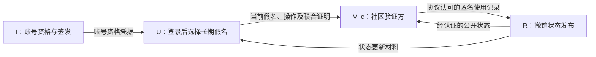
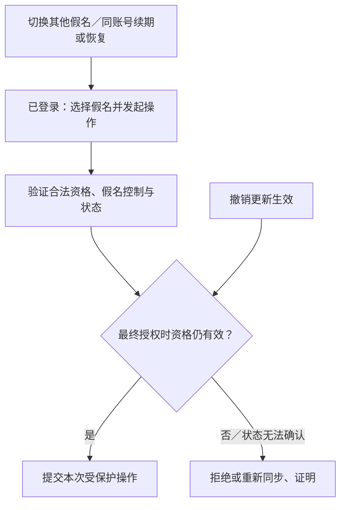

# 多假名匿名社区统一撤销：研究方向与产品改造依据

更新日期：2026-11-17。本文集中保存已经确认的研究方向、立题依据、研究边界、候选基线及产品改造路线，作为开题、后续调研和实现任务的共同入口。交付状态见[本次任务记录](../tasks/THESIS-RESEARCH-DIRECTION-20261116.md)。

**已确认：SpeechFUL 后续按论文的隐私目标改造。** 社区验证方应能验证资格、执行统一撤销，而不需要常态掌握同一账号的多个假名之间的关系。本轮交付为研究与改造方案文档；具体密码构造、代码改造及存量数据迁移尚未完成。下文明确区分需求、候选方案和待验证结论。

## 1. 已确定的方向与题目

| 项目 | 当前结论 |
| --- | --- |
| 论文题目 | **《多假名匿名社区的统一撤销与隐私保护机制研究》** |
| 研究方向 | **隐私保护与匿名认证**；具体涉及匿名凭据、隐私保护访问控制和资格撤销 |
| 研究对象 | 同一社区中，由同一账号资格支持的多个长期假名 |
| 核心问题 | 在社区验证方不掌握跨假名对应关系的条件下，使账号资格撤销约束其支持的全部假名的后续受保护操作，并分析历史隐私和完整运行成本 |
| 应用载体 | SpeechFUL 的账号登录、长期假名使用及业务授权流程 |
| 当前阶段 | 研究目标与业务语义已确定；构造选择、安全证明、基线复现和实验结论仍需完成 |

题目保留“匿名”。这里的匿名需要给出观察者与信息边界：同一假名内部保持公开连续性，不同假名之间的共同账号关系应对社区验证方隐藏；这不等于对所有参与方、所有日志和所有网络侧信道都绝对匿名。

研究不要求一定发明新的底层密码算法。现有构件的组合可以形成研究贡献，但须说明新增的安全问题、组合条件或可测量的改进，不能只把多个论文名称拼接后宣称创新。

## 2. 已确认的业务语义

### 2.1 登录、账号资格与假名使用

基本流程是“邮箱资格验证 → 获取账号资格凭据 → 检验资格有效性 → 使用长期假名”。用户在登录 APP 后选择或切换假名，假名不被当作另一个独立登录账号。登录是否每次要求邮箱验证属于产品入口细节，不是论文必须采用的前提。

账号资格凭据在本文中也称“根凭据”，二者是同一个对象。它证明持有者具有相应社区资格；当前操作还需要证明对当前假名的控制权，并满足当前撤销状态。APP 显示已登录、切换假名成功，都不能代替最终业务授权。

例如，同一账号持有长期假名 A、B、C。系统依据 A 的一条有效匿名使用记录撤销对应资格后，B、C 的后续受保护操作也应失败。社区无需找到 B、C 的名称，也无需建立一张可查询的共同账号名单。这里的“可验证”是指共同资格约束和操作验证结果可检查，不是向社区枚举全部受影响假名。

### 2.2 哪些关系可以知道，哪些需要隐藏

| 信息或关系 | 已确认目标／边界 |
| --- | --- |
| 邮箱与账号的资格关系 | 注册／签发流程可维护、查询；不要求对所有注册参与方隐藏这层关系 |
| 当前假名及其公开内容 | 社区可见；同一长期假名的内容允许关联 |
| 不同假名是否属于同一账号 | 社区验证方不应通过正常协议、业务字段或可访问日志直接获得这层关系 |
| 某次操作是否由有效资格持有者发起 | 社区需要验证，但不因此获知账号标识或其他假名 |
| 撤销是否作用于同一隐藏资格 | 必须由协议保证；不能预设社区已经知道隐藏账号编号 |
| 撤销后所有假名的未来权限 | 受同一资格约束；不要求服务端逐个定位或展示封禁对象 |
| 同账号续期、再次邮箱验证或凭据恢复 | 应继承原资格的撤销约束，不能因此取得一份脱离原约束的新资格 |
| 不同邮箱重复注册 | 单独依赖注册制度；邮箱控制权不等于自然人唯一性 |

“服务端不知道关联”需要落实到权限和数据流：如果社区仍收到共同账号 ID、同一个 Bearer、Cookie 或可跨请求查询的会话标识，就可能直接关联不同假名。改为两个服务名称或两个进程，不能自动消除这种关联。

## 3. 立题依据

### 3.1 应用中的实际矛盾

长期假名允许用户在不同交流情境中保持各自的历史、声誉和持续互动。与此同时，平台需要把资格约束施加到同一资格支持的全部操作，避免资格已失效后仍利用其他假名继续访问受保护功能。

若社区持有账号到全部假名的映射，按账号检查状态即可实现统一限制；这本身不构成本文要解决的密码学问题。论文增加的约束是：**社区验证方在完成这些检查时，不应获得跨假名的共同账号关系。** 因而立题依据应落在资格约束与验证方隐私之间的兼容性，而不是把“切换假名”误写成现有账号封禁天然失效。

此外，已经登录的 APP 包含身份列表、会话续期、内容归属、本人通知和恢复流程。即使证明系统本身不可关联，外围接口也可能暴露共同账号关系。因此需要把密码协议的隐私目标放到真实应用的数据流中检验。

### 3.2 现有研究已提供的能力

匿名凭据已经研究多次不可关联展示及凭据的一致性；这些是可以借用的基础，而不是本课题新提出的性质。参考 Camenisch 与 Lysyanskaya 的原始工作。[匿名凭据原文](https://cs.brown.edu/people/alysyans/papers/cl01a.pdf)

多假名统一撤销也已有直接先例。Brands、Demuynck 与 De Decker 的工作研究了依据一个假名撤销同一用户其他不可关联假名的系统。因此，本课题不能宣称“首次实现不知道其他假名也能统一撤销”。需要逐项比较其使用范围、信任假设、泄漏与成本。[出版社论文与摘要](https://link.springer.com/chapter/10.1007/978-3-540-73458-1_29)

SNARKBlock 通过隐藏共同输入的聚合证明和分块处理支持匿名阻断，原方案已有证明复用能力。ALPACA 进一步研究可更新证明，其摘要和作者实现说明强调在线证明、验证和证明大小的规模性质。两者说明“共享根资格”“复用已有计算”“增量更新”都不能直接被列为我们的原创贡献。[SNARKBlock 原文](https://www.cs.umd.edu/~imiers/pdf/snarkblock.pdf)、[ALPACA 论文记录](https://eprint.iacr.org/2025/767)

据这些来源，目前更合理的立题位置是：**研究上述机制如何满足已登录、多长期假名 APP 的共同资格约束和信息边界，找出直接组合的真实缺口，再提出并验证必要的改进。** 这是根据应用需求作出的研究判断，尚不是“现有方案均无法做到”的结论。

### 3.3 仍需回答的研究问题

1. 合法凭据、当前假名控制权与未撤销证明，如何绑定同一隐藏资格，避免从不同持有者处拼接证明？
2. 如何依据协议认可的匿名使用记录形成撤销约束，使同一隐藏资格的其他假名也失效，同时不引入可公开关联的稳定标识？
3. 账号登录、假名展示和最终业务授权分别暴露什么？协议的不可关联性在应用会话和日志中是否仍成立？
4. 撤销生效、并发提交、离线返回和凭据恢复，如何保持一致的资格约束？相应成本是多少？
5. 在保留基线全部既有优化的条件下，多长期假名适配新增了哪些开销，其中是否存在新的安全复用或状态维护优化？

前两个问题不预设已有方案缺失相应能力；如果基线已经覆盖，应记录复用方式并缩小创新主张。研究问题的价值来自明确的模型、反例、论证与测量。

### 3.4 工作量与成果边界

该方向能够形成“模型与安全目标 → 直接组合与失效分析 → 改进机制 → 原型与实验”的完整研究链条。范围集中在账号资格与多个长期假名的关系，已有足够的协议和系统交叉问题；没有必要为了扩大题目加入身份追踪、通知系统或内容识别算法。

硕士论文的工作量与期刊论文的新颖性是两个判断。原型集成可以贡献工作量，但期刊主张仍需要相对于既有研究的明确增量。如果复核发现现有方案已完整满足目标且没有新的分析或实测贡献，应调整贡献表述或研究切口，不能用工程代码量代替新颖性。

### 3.5 能否形成论文与期刊投稿成果

当前判断是：**该方向值得继续开展硕士论文研究，但期刊所需的学术增量尚未得到证实。** 题目范围集中不是主要风险；主要风险是将既有方案已经实现的能力误写成新贡献。课题获准、开题通过、达到学位论文要求和期刊录用也不是同一项验收。

面向期刊，当前优先检验第 8 节提出的“批量同步与不同类型更新的分离处理”，目标是降低匿名资格维护成本，再评价它在多长期假名、离线返回及并发更新中的效果。共同资格约束、状态过期重试和跨假名隐私仍作为安全与应用边界。这个切口有作者代码作为依据，但具体收益与新颖性仍须通过同条件比较和进一步文献核查确认。

| 可形成的成果路径 | 至少应交付的实质内容 | 不能替代该内容的工作 |
| --- | --- | --- |
| 组合与安全分析 | 明确的新增应用条件、非人为制造的失效反例、修正机制及相应论证 | 给已有性质换名、只画架构图、删掉基线检查后制造漏洞 |
| 机制与性能改进 | 保持相同安全目标的新机制；相对公平直接组合的可复现收益及代价 | 移到后台后不计成本、使用更弱参数、重复维护本可共享的状态 |
| 系统与实验研究 | 可推广的问题和设计结论；完整的信息流分析、实现与多条件实验 | 只展示 APP 功能、只复述作者图表、单一环境的一次跑分 |

不必三条全部完成，但应形成至少一条完整、证据充分的主线，并用其他部分支撑它。选定切口后再把期刊论文题目收窄到实际贡献；当前开题题目可以作为整体研究范围保留。

继续投入的判断节点应放在大规模产品改造之前：完成核心构造复核和最小直接组合，交付性质对照、初步测量以及一个候选贡献说明。若已找到未被覆盖的问题且修正有理论或实测价值，继续深化；若现有方案已经直接满足目标、没有新的分析结论或收益，就调整研究切口。不能以“APP 还需大量改代码”作为继续宣称论文创新的依据。

当前尚未确定目标期刊及学校认可要求，因此不承诺录用或具体期刊层级。后续选刊应根据实际成果、论文类型和导师要求匹配，而不反过来用未经验证的性能承诺包装成果。

## 4. 研究范围与隐私承诺

### 4.1 纳入范围

- 同一社区、同一账号资格下的多个长期假名。
- 凭据有效性、当前假名控制权与当前未撤销状态的联合验证。
- 基于有效匿名使用记录的资格撤销，以及对后续受保护操作的一致约束。
- 撤销前历史记录的跨假名隐私，及撤销发生后观察既有记录时的关联风险。
- 状态更新、缓存、离线积压、并发授权及账号凭据续期／恢复的条件。
- 原型、直接组合基线、改进方案及完整成本实验。

### 4.2 不纳入本轮论文核心

真实身份揭示、门限追踪实现、邮件通知、历史内容删除、内容审核分类算法及网络匿名通信，不作为本课题的研究模块。身份开启和多机构追踪仅可用于相关工作及隐私风险讨论，不构成当前方案的接口或创新点。

产品可能需要禁言、限时限制和恢复资格。首轮密码原型建议先验证最小的资格撤销语义；期限、作用范围、解除限制和旧证明是否恢复有效需要另外定义，不能假设任意黑名单方案天然支持这些行为。这是分阶段实施建议，不表示取消产品需求。

### 4.3 敌手与允许泄漏

隐私分析以社区验证方能够观察的协议消息、业务字段和实际可访问日志为基础。至少区分被动记录、主动重放／探测，以及签发方与社区方串通的情形；不能把“不串通”默认为已经实现的组织或技术事实。

可以显式建模的公开信息包括当前假名、同一假名的公开历史、公开撤销状态及认证结果。认证成功或失败本身可能提供关联线索，特别是在定向列表、少量用户或主动探测情境中。必须说明隐私实验的约束与泄漏，而不能只凭使用零知识证明就声称完整历史不可关联。

共同账号标识、跨假名会话 Cookie 或可查询的身份映射，直接违背所讨论的目标，不能通过把它们列入“允许泄漏”来使结论形式上成立。IP、时序、写作风格及设备侧信道不在基础密码协议的保证范围内，应用评估仍应记录其存在。已泄漏给服务端的历史映射，也不能仅靠部署新协议就被证明遗忘。

## 5. 简要系统模型

### 5.1 角色与数据

论文使用四个逻辑角色。为避免与仓库现有校邮验证服务 V 混淆，本文将**社区验证方**写作 `V_c`；该符号不表示当前 V 服务。

| 角色／对象 | 含义 |
| --- | --- |
| `U` | 用户客户端，持有凭据、秘密和假名控制材料，登录后选择当前假名 |
| `I` | 账号资格与签发角色，负责注册资格和凭据签发；具体部署及查询权限待设计 |
| `R` | 撤销状态发布角色，处理有效撤销输入并发布经认证的状态 |
| `V_c` | 社区验证方，验证当前假名的受保护操作 |
| `a`、`q_a`、`C_a` | 账号、稳定的隐藏资格、绑定该资格的账号资格凭据 |
| `x` | 持有者秘密；不能把掌握这个秘密解释成自然人唯一性证明 |
| `S`、`p`、`m`、`n` | 社区、当前长期假名、当前操作、单次挑战 |
| `Σ_v` | 版本为 `v` 的经认证撤销状态 |
| `w_p`、`w_v` | 假名控制与当前资格状态的私有见证 |

`q_a` 是分析中的稳定资格对象，不要求作为社区可见的数据库键。注册服务可查询邮箱与账号，也不意味着必须知道客户端秘密 `x`；秘密生成、签发可见性和串通假设须由具体构造明确。



图中的角色划分表达待实现的信息边界，不是“拆成几个服务就已经匿名”的证明。`I`、`R`、`V_c` 的实际部署、权限和串通能力必须另行核对。

### 5.2 共同见证关系

公开上下文 `Γ` 至少包含 `S、p、m、n、v`；私有见证 `W` 包含 `q_a、x、C_a、w_p、w_v`。以签发公钥 `pk_I` 表示合法签发验证所需参数，目标关系为：

```text
R(Γ, Σ_v; W)
  = CredOK(pk_I, C_a; q_a, x)
  ∧ NymOK(S, p; q_a, x, w_p)
  ∧ Eligible(q_a, Σ_v; w_v)
```

三个谓词分别表达合法资格、当前假名控制权和未撤销资格，并须约束同一 `q_a` 与 `x`。证明或其认证上下文还必须绑定本次操作、社区、挑战和状态版本，避免用于另一操作或重放。仅把这些字段写进符号列表，并不等于实现了绑定。

该关系是安全规格，尚未指定电路、签名、承诺、假名派生函数或证明系统。不能由这条公式直接推出安全性或效率；需要核查候选构件的公开输入、秘密分布、编码方式和证明假设是否兼容。

### 5.3 匿名记录到撤销约束

撤销输入记为有效匿名使用记录 `d`。需要给出一个可核验的更新流程，使状态变化约束产生 `d` 的同一隐藏资格。不可把这一关键接口简化为“读取账号 ID 后封禁”，再声称社区不知道账号归属。

协议还应防止伪造记录或替换绑定材料导致无关资格失效。撤销判定所依据的社区规则与处理程序属于产品治理，密码协议只证明输入有效、约束对应正确及后续检查一致，不自动证明处理决定本身正确。

### 5.4 生效语义与基本性质

建议以最终业务授权／提交点作为撤销生效检查边界，使撤销更新和业务提交有可解释的一致先后关系。撤销已经生效后，旧登录状态、缓存证明和假名切换均不能免除当前资格检查；状态新鲜性不确定时，需要明确等待、重新证明或拒绝的路径。



需要论证或验证的性质包括：有效资格正常可用、资格不可伪造、假名控制权一致、统一撤销可靠、无关资格继续可用、抗重放，以及给定泄漏模型下的跨假名隐私。全部拒绝虽然能阻止已撤销资格，也不满足正确性和可用性。

严格的新鲜状态要求可能使正在生成的证明过期。具体状态版本策略尚待比较，实验必须计入重试、失败率和可用性，不能只报告一次证明的密码运算耗时。

## 6. 候选基线与文献核实状态

下表为当前已定位的关键来源，核实日期为 2026-11-16 至 17 日。它不是完整系统综述，也不表示已经精读或复现了 200 篇论文。

| 工作 | 可借鉴或比较的部分 | 已核实证据 | 尚未完成 |
| --- | --- | --- | --- |
| Camenisch–Lysyanskaya 匿名凭据，2001 | 凭据持有证明、多次展示及一致性；用于模型和构件背景 | 原文摘要及引言 | 与候选阻断实现的具体接口兼容性；不默认整套嵌入 |
| Brands–Demuynck–De Decker 全局假名撤销，2007 | 直接比较“多个不可关联假名统一撤销”的既有能力与安全边界 | 出版社摘要及正式论文元数据 | 全文逐项安全比较、适配和性能复现 |
| **SNARKBlock，IEEE S&P 2022** | 隐藏共同输入聚合、分块复用；证明、验证、同步成本 | 原文相关章节、实验章节、作者代码 README | 本机编译运行、完整证明审读、固定版本复现 |
| **ALPACA，IEEE S&P 2025** | **主要候选基线**；可更新匿名阻断证明和完整维护成本 | ePrint 摘要及出版信息、作者 README、同步／授权／解禁代码及电路适配入口 | PDF 全文逐项复核、编译、实验复现及适配开销 |
| **zk-BAN，2026 预印本** | 签名式撤销、离线返回和计算成本的近期对照候选 | ePrint 摘要及预印本元数据 | 全文、代码归属、可运行性、原始数据和可比功能；尚未确认为实测基线 |

代码与实验材料必须分开记录：

| 方案 | 公开实现入口 | 当前可确认的运行入口 | 原始实验数据状态 |
| --- | --- | --- | --- |
| ALPACA | [alpaca](https://github.com/jiwonkimpark/alpaca)、其 README 指向的 [circ-alpaca](https://github.com/jiwonkimpark/circ-alpaca) | README 提供构建说明与 `cargo run --release --example example` 示例 | 未完成机器可读原始结果及完整绘图材料的核验；公开代码不等于原始结果齐全 |
| SNARKBlock | [snarkblock](https://github.com/rozbb/snarkblock)、[hiciap](https://github.com/rozbb/hiciap) | README 指向 `run_benches.sh` 及 Criterion 输出 | 论文有实验图表；尚未确认作者全部原始运行记录可直接下载 |
| zk-BAN | 尚未核实作者代码入口 | 尚未核实 | 摘要报告性能结果，不能当作已取得实验数据集 |

以上入口只表明公开材料存在，不表示代码已经适配当前环境、经过本项目安全审计或可以直接上线。复现前固定依赖、提交版本和参数。BLAC、PEREA、动态累加器、范围可撤销假名及其他近期匿名阻断工作仍需继续做性质比较；不能因当前表较短就推断只有一篇可比较论文。

国内相关匿名凭据和身份认证研究应继续补充原始来源，按实际机制与安全定义比较；当前证据不足以对“国内研究整体缺少何种能力”作概括性判断。

## 7. 直接组合基线怎么建立

### 7.1 最小组合的组成

优先考察 ALPACA 原有签发／身份绑定及匿名阻断机制，在其允许的接口上接入长期假名控制证明，再接入受保护操作上下文和状态版本检查。SNARKBlock 按相同目标建立对照。具体假名绑定方式在核对构造后选择，不预先指定某个派生公式就宣称组合完成。

| 部分 | 可以直接借用的方向 | 必须核查或补齐的内容 |
| --- | --- | --- |
| 资格与持有者绑定 | 候选方案已有的身份／签发接口 | 与邮箱注册资格的衔接；重签发是否保留撤销约束；签发方能观察什么 |
| 匿名阻断 | ALPACA 或 SNARKBlock 的原有机制 | 撤销输入记录是否充分绑定资格；原有安全定义是否覆盖目标用法 |
| 长期假名 | 现有凭据及假名控制技术 | 同一资格支持多个长期假名的证明关系、公开标识及可关联信息 |
| 状态维护 | 基线原有更新、分块、缓存与随机化 | 应用适配新增材料是否可复用；版本过期和离线返回如何处理 |
| 业务授权 | SpeechFUL 最终业务检查的职责 | 如何用隐私保护的资格和归属证明实现职责，避免继续向社区提供账号关联 |

不能假设把几个独立证明并排提交就满足共同见证，也不能用固定公开根承诺来绑定全部展示而忽略它本身可能成为关联标识。

### 7.2 三组比较

1. **作者原方案**：按论文自己的功能与参数运行，确认实现和计时边界；用于复现与参考。
2. **满足本文语义的直接组合**：保留作者已有能力，补齐长期假名、上下文和状态接口；作为新增改进的主要比较对象。
3. **直接组合加本课题改进**：仅改变待论证的新部分，保持相同功能、安全参数、硬件和负载。

作者的缓冲、分块大小或更新方式等实验变体，是同一方案的配置，不应自动当作多篇独立 baseline。不同论文功能不一致时可以做性质、复杂度或局部开销比较，不强行输出一个总速度排名。

尤其不能人为让 ALPACA 为每个假名完整重复维护一套本可共享的持有者状态，然后把消除这种重复当作创新。消融实验应开关本课题新增机制，同时保留必要安全检查和基线原生优化。

## 8. 研究内容与可能贡献

**性能改进可以独立形成贡献，不要求增加前人从未支持的功能。** 已有方案支持删除、批处理或匿名证明，并不排除我们在这些功能上做得更快、更省内存，或者在某类负载下取得更好的综合成本。需要提出并解释改进机制，在对齐安全目标和条件的比较中报告收益与代价；不能仅凭“有某功能”或某一次跑分认定创新成立。

性能贡献不必降低渐近复杂度，也不必在所有指标和场景上同时领先。针对离线积压、内存受限客户端或频繁更新取得可复现且有意义的改善，也可以形成研究结果。没有一个通用的“提速多少就算创新”的百分比门槛；应说明适用条件、原因、已有工作的覆盖范围，以及收益是否来自所提出的方法。

| 研究内容 | 可能形成的贡献 | 需要成立的证据 |
| --- | --- | --- |
| 已登录、多长期假名应用的隐私模型 | 明确账号登录、假名使用、认证结果及日志之间的关联边界 | 相对既有定义的真实差异、可解释反例和形式化安全目标 |
| 共同见证与撤销接口适配 | 给出组合条件、失败情形和满足目标的构造／适配 | 防拼接、防误撤销、正确性及撤销可靠性的论证；不能仅靠流程图 |
| 撤销状态与最终业务授权 | 明确并发、缓存、旧证明和离线返回的生效语义 | 可复核事件序列、反例修正，以及一致的授权验收 |
| 资格更新与展示的计算优化 | 批量状态转换、分类型增量验证或展示包装改进，降低维护或在线成本 | 保留基线原生优化；同条件实测、组合安全论证及适用区间；无收益时如实报告 |

目前这些是待验证的贡献候选，不能在开题或论文中写成已经完成的算法创新、已证明性质或已达到的性能指标。门限追踪、通知、普通身份切换界面不作为“补足创新点”的附加模块。

### 8.1 从原文与实现定位瓶颈

| 来源与核实位置 | 已观察到的机制／限制 | 可以研究的性能问题 |
| --- | --- | --- |
| ALPACA 作者 `src/blocklist.rs`：`synchronize`、`updatable_synchronize` | 对尚未同步的记录逐条调用更新，每次推进 IVC；已有状态可以续算 | 每条记录都承担的证明维护开销能否按批次摊薄；不减少应检查的记录 |
| 同文件 `f`、`rerandomize_usync_proof`；`f_circuit.rs` 与 `r1cs_adapter.rs` | 处理凭据、普通记录、解禁及重随机化等逻辑；当前电路入口加载同一份 `IVC_R1CS` | 普通更新是否承担过多通用电路成本；分离电路后节省是否大于切换与隐藏分支的代价 |
| 同文件 `authorize_token`，及 `relation_nova/zksnark.rs` | 授权会调用重随机化、IVC 压缩证明及发帖关系证明 | 各阶段中是否有可合并、复用或替换的开销；不能直接删除匿名性与共同见证所需步骤 |
| SNARKBlock 原文第 7、8.2、8.3 节 | 已有分块与缓冲，仍需同步工作；冷启动需要准备既有列表对应材料 | 离线积压、批次大小、内存与在线延迟之间的取舍；已有分块本身不作为我们的新机制 |
| zk-BAN ePrint 摘要 | 通过列表筛选和部分统一 PRF 标签减少重复计算 | 说明“减少必要计算之外的冗余”是相关路线；全文当前未取得，不引用二手材料中的内存或延迟数值作为已核实局限 |

ALPACA 代码核对日期为 2026-11-17，`src/blocklist.rs` 的 Git blob 为 `240a2bca9bf017d08d725331dd51a092386a27bc`，`f_circuit.rs` 为 `5daa67623b66ded254dcc80dd6c67701738961c7`。blob 用于标识已读文件内容，不是本项目提交。公开入口：[同步与授权代码](https://github.com/jiwonkimpark/alpaca/blob/main/src/blocklist.rs)、[电路入口](https://github.com/jiwonkimpark/alpaca/blob/main/src/proofs/relation_nova/ivc/f_circuit.rs)、[压缩证明](https://github.com/jiwonkimpark/alpaca/blob/main/src/proofs/relation_nova/zksnark.rs)。上述阅读没有测出各环节耗时占比，后续必须先做分项测量。

### 8.2 候选 A：批量撤销同步，减少每条记录的重复维护开销

**拟改动：** 保留 ALPACA 的连续状态与匿名展示语义，将连续 `b` 条记录的检查放入一个批量状态转换。每条记录仍做资格相关检查，批次内部验证完整顺序，折叠／递归状态的维护以批次为单位完成。SNARKBlock 的分块思想可作为组织方式参考，HyperNova 的多实例折叠可作为进一步技术候选；两者都不是直接套用后就自动满足 ALPACA 的匿名增量证明定义。

以 `d` 表示待处理记录数、`F` 表示每步固定维护成本、`C` 表示每条检查成本，第一轮可用如下假设指导测量：

```text
逐条处理：T ≈ d × (F + C)
批量处理：T ≈ ceil(d / b) × F_b + d × C_b + T_binding + T_padding
```

`F_b` 和 `C_b` 必须实测，不能假设批量后与原值相同。目标是降低常数开销，不预先承诺把完整同步从线性复杂度变成常数。批次变大也可能增加内存、等待时间和电路参数成本。

**必须保留：** 起止状态绑定、记录连续性、真实批次长度、尾批填充约束、同一隐藏资格，以及全部被处理记录的有效性；不能跳过导致本资格撤销的记录。私有同步材料可复用，跨假名公开展示仍要满足随机化和不可关联要求。

**首轮实验：** 原始逐条更新、固定批次 `b=2/4/8/16`、内存受限的批次选择；比较每条记录耗时、离线追赶总耗时、峰值内存、在线等待及尾批成本。先固定批次验证收益，再决定是否研究自适应选择。该候选改动位置清楚，建议首先进行预实验。

### 8.3 候选 B：普通更新与特殊处理分离，降低通用电路负担

**拟组合：** ALPACA 的资格状态转换，结合 SuperNova／HyperNova 的非统一增量计算思想，将初始化、普通更新、解禁处理和展示准备定义为不同类型的转换。每种转换仍证明完整的安全条件，普通更新尽量只承担实际需要的约束。[SuperNova 原始说明](https://eprint.iacr.org/2022/1758)、[HyperNova 当前版本](https://eprint.iacr.org/2023/573)

这不是把 Rust 中的 `if` 拆成几个函数。要核对编译出的约束和状态机，证明凭据在初始化验证后，后续每一步始终继承同一合法资格；否则移除重复签名检查会变成安全缺口。分支类型、调用次数或选择器如果对外可见，还可能泄漏是否曾被限制、何时恢复等信息，因此必须分析隐藏分支所需的成本。

**可能的贡献：** 面向匿名撤销的状态转换划分、绑定不变式和隐私保持方法，以及普通更新占多数时的性能改善。即使证明后端已经存在，针对该协议的安全适配和经实测成立的成本改善仍可作为贡献候选；单纯升级依赖则不足以说明这一贡献。

**首轮实验：** 对齐安全参数，分别测量原电路与分离电路的约束数、证明时间、参数／状态大小；改变普通更新与特殊处理的比例。用 A、B 分别启用和同时启用的消融比较，区分批量收益与电路划分收益。建议将 A、B 视为一条“低开销资格维护”主线的两个候选机制，不预先凑成两项独立原创结论。

### 8.4 候选 C：研究匿名展示所需的证明包装能否简化

ALPACA 作者实现的授权路径包含重随机化、IVC 压缩及发帖关系证明。HyperNova 当前扩展版说明了 NovaBlindFold：利用折叠的盲化性质实现零知识。可以研究把这类方法用于匿名资格展示，是否能减少部分包装开销，同时绑定当前长期假名与本次操作。[ALPACA 授权实现](https://github.com/jiwonkimpark/alpaca/blob/main/src/blocklist.rs)、[HyperNova 摘要与版本说明](https://eprint.iacr.org/2023/573)

**关键限制：** 零知识不自动等于多次展示不可关联，也不自动保证证明简短。不能仅因为有盲化方法就删掉压缩步骤；还需检查跨次公开输入、历史状态、证明大小、验证成本，以及新增假名证明能否保持共同见证。HyperNova 的 2026-02-20 版本说明是把已有附录结果移至第 7 节并命名 NovaBlindFold，不能将其误写为 2026 年才首次出现的全部技术。

该候选可能直接影响在线操作延迟，但构造兼容性风险高于 A。先列为备选，取得相关完整构造并完成兼容性分析后再投入实现，不声称已经证明可替换。

### 8.5 其他方案如何用于比较，哪些思路仍然值得做

ShadowBlock 研究动态累加器更新和删除；这说明删除功能已有相关方案，**不表示更高效的删除、低内存更新或更快恢复不能成为创新**。若选择这条路线，需要与其动态方法及 ALPACA 的解禁处理在相同语义下比较；其对其他方案的评价也须回到各原文核对，不能照抄比较表。[ShadowBlock 原文，第 IV—VI 节](https://arxiv.org/html/2512.19124v1)

FAB 的当前版本把服务划分为多个 realm，使用范围内稳定假名；它提供另一种减少同步工作的思路，但成本会随信任的 realm 数增加。我们的同社区多假名目标与其范围语义不同，不能把改用单个稳定假名得到的速度优势算作同等隐私条件下的提升。[FAB v2，第 4、7 节](https://arxiv.org/html/2511.03486v2)

当前优先顺序为 **A 预实验 → B 兼容性与约束分析 → A+B 组合评估**，C 为较高风险备选。开题可描述为“拟研究批量与分类型增量验证机制，降低资格维护开销，并保持多假名统一撤销与跨假名隐私”。这一表述给出了具体研究动作，没有预设提速比例或录用结果。

本轮已读 SNARKBlock 相关原文、FAB 与 ShadowBlock 的相关章节、ALPACA 作者关键代码，以及 SuperNova／HyperNova 的原始摘要和版本说明。ALPACA、zk-BAN 与 HyperNova PDF 接口本轮返回 403，不能写成已经通读其全文。有限关键词检索也不足以证明组合从未被研究；后续应继续核对引用链、相关版本及同类批处理工作。

## 9. 实验与大规模评估

### 9.1 数据来源与规模含义

此类实验主要需要协议有效的凭据、匿名使用记录、撤销项和操作序列，不要求收集真实用户帖子。使用合成账号和真实密码运算生成输入，并验证输入合法性。随机字节填满列表、跳过证明生成或使用固定返回成功的验证器，都不能冒充真实协议性能。

规模首先按撤销列表长度 `N`、每份资格的假名数量 `k`、新增撤销量 `ΔN`、离线积压和请求并发来定义。`N` 不自动等于自然人数、APP 注册人数或活跃人数：同一资格可能产生多个记录，具体单位取决于基线定义，比较前必须对齐。

APP 当前用户少并不妨碍用合成有效输入测试较大协议规模。建议先从可重复的小、中规模开始，例如 `N = 10²、10³、10⁴`，根据预实验资源逐步增加至 `10⁵`；百万级作为资源允许时的上探目标。`k` 可先比较 `1、3、10` 等配置，均为实验建议而非已完成结果或硬性产品容量。

### 9.2 测量边界

| 维度 | 需要记录的指标 |
| --- | --- |
| 首次使用 | 参数生成／加载、资格和初始状态准备、冷启动耗时与内存 |
| 持续维护 | 状态下载、增量更新、后台预计算、长期离线返回同步成本 |
| 在线操作 | 证明生成、验证、最终业务授权与端到端延迟 |
| 空间与通信 | 证明大小、客户端状态、服务器状态、下载及上传量 |
| 并发与可用性 | 吞吐量、延迟分布、过期证明、重试次数、拒绝／失败率 |
| 正确性 | 有效资格可用、同资格撤销覆盖、无关资格不受影响、旧状态与重放拒绝 |

分别报告在线、后台和累计成本，说明摊销分母。固定安全参数、硬件、线程数、依赖版本、预热条件和生成方法，重复运行并报告中位数、尾延迟及离散程度；失败运行也应留有记录。

### 9.3 作者数据、自己的测量与推算

作者图表及公开数据可以用来理解负载、选择参数和检查复现趋势，引用时注明硬件、版本和计时边界。它们不替代本方案及直接组合在相同条件下的测量。

如果资源不足以运行最大规模，应报告实际达到的最大规模、耗时、内存和失败原因。基于复杂度或小规模测量进行的外推单列为估算，给出假设和适用范围，不能与实测点混画成同一类实验结果。期刊目标需要更充分的可复现证据，而不是把他人的大规模数字写成本项目数据。

仓库优先保存文献名称、原始链接、核实范围，以及后续实验脚本、参数和适当大小的合成结果。无需保存全部论文原文，也不上传真实账号、邮箱、私钥、学籍信息或用户内容。

## 10. SpeechFUL 现状与改造目标的差距

本节核对基线为 `fed946b0d67dceb8ef9e27cd57310cf9ef9e7b40`。现状来自仓库代码和文档；目标来自已确认的论文语义及“按照论文目标来进行改造”的用户指令。

| 环节 | 已核对的现状 | 目标与改造影响 |
| --- | --- | --- |
| 身份归属 | `community_identities.account_id` 直接关联账号；参见[身份迁移](../../services/api/migrations/0011_identity_management.sql) | 社区验证方不能保留可直接枚举的跨假名映射；必须重新设计身份控制与归属验证 |
| 本人身份列表 | 当前接口按本人账号／Bearer 返回身份列表；参见[API 身份说明](../../services/api/README.md#b02身份管理基础) | 共同账号会话与身份目录可能直接泄漏关联；需要评估客户端管理及恢复方式 |
| 资格注册 | [邮箱—账号协议隔离](../../GLOSSARY.md) 使用校邮与社区两侧关系 | 论文允许查询邮箱与账号资格，但不因此授权把账号标识送入匿名社区操作；论文角色不能直接照搬当前 C/V 命名 |
| 内容归属 | 帖子、评论等使用账号归属字段；参见[帖子迁移](../../services/api/migrations/0013_community_text_posts.sql)、[评论迁移](../../services/api/migrations/0016_comments.sql) | 不能只删除身份表中的一个字段；编辑、删除、本人内容和归属校验都需要适配 |
| 处罚 | 当前处罚对象关联账号；参见[审核迁移](../../services/api/migrations/0015_reports_moderation.sql) | 需要从有效匿名记录建立共同资格约束，同时区分禁言、封禁、时限与解除 |
| 最终业务检查 | 现有服务要求会话、代次、资格和资源归属检查；参见[协作验证约束](../../CONTRIBUTING.md#认证数据库与测试资源) | 改造要保留这些安全职责，不能以“隐私”为由绕过最终业务授权；具体承载方式需新设计和验证 |
| 通知、私信与恢复 | 存在账号共享状态和当前查看身份；参见[领域术语](../../GLOSSARY.md) | 虽然不作为论文创新模块，完整产品仍需检查它们是否反向暴露跨假名关系 |

因此，产品改造涉及认证、身份目录及业务归属的整体信息边界，不能仅通过不展示账号编号或删除管理页面查询按钮完成。现有功能通过了什么验收，仍以原任务记录为准；本研究文档不把现状重标为已满足新隐私目标。

## 11. 已确定目标下的分阶段改造路线

用户已确认本轮先固化方案并推送。以下是建议实施顺序，不是已经完成的实现，也不产生修改正式数据或部署的授权。

| 阶段 | 工作与交付 | 进入下一阶段的依据 |
| --- | --- | --- |
| 1. 事实与边界 | 梳理账号、会话、身份、内容归属、通知、私信及日志的信息流；固定核心论文和代码版本 | 明确哪些参与方能看到什么；完成必要产品取舍 |
| 2. 基线复现 | 跑通 ALPACA 最小样例及 SNARKBlock 对照，建立可重复的输入和测量脚本 | 确认构件可用、成本可测、计时边界一致 |
| 3. 最小协议原型 | 合成账号下完成资格签发、两个以上长期假名、操作证明、匿名记录撤销及无关资格继续使用 | 共同见证和撤销接口明确；安全目标与反例有依据 |
| 4. 业务试接入 | 先接入一条完整的受保护操作链路，检查最终业务检查、状态并发及日志 | 功能与真实信息流均满足目标；不能只验接口返回成功 |
| 5. 扩展与评估 | 扩展相关业务，比较直接组合和新机制，进行资源允许的大规模实验 | 适用产品测试、隐私论证及性能证据齐全 |
| 6. 迁移与交付 | 形成存量账号／假名迁移、恢复、兼容及回退方案 | 单独确认迁移和正式发布边界，按仓库要求验收 |

后续实现前尚需确认的产品取舍集中在以下几类；它们不影响本轮保存已确定方向：

- **隐私对手范围**：社区验证方是否包括网关、日志运维和可联合查询数据库的运营主体；签发方与社区方串通时要求到什么程度。
- **身份恢复**：换设备或丢失客户端秘密后，是否恢复全部长期假名；恢复能力由谁持有，会引入什么关系泄漏。
- **存量迁移**：既有服务端映射及备份已经存在，如何区分新协议记录与旧历史；不能承诺对既有知情方“抹去记忆”。
- **跨身份业务规则**：本人聚合页面、通知、私信、累计身份数量、帖内身份绑定等如何保留，并避免重新引入可关联账号键。
- **限制范围与期限**：永久资格撤销、禁言、期限结束和申诉恢复分别影响哪些操作，是否允许旧能力重新生效。

这些取舍确定后，再写具体接口、迁移及实现任务；当前不为未知构造承诺完成日期或固定性能收益。

## 12. 研究验收与当前证据

| 场景 | 期望检查 |
| --- | --- |
| 正常登录后切换 A、B | 当前假名可用；假名操作不会把共同账号会话暴露给社区验证方 |
| 撤销 A 对应资格后使用 B、C | 生效后的受保护操作被拒绝；无需枚举 B、C |
| 另一有效资格继续操作 | 正常接受，不因局部撤销使所有资格失效 |
| 同账号重新验证邮箱、续期或恢复 | 原撤销约束持续存在 |
| 拼接别人的未撤销证明与自己的假名 | 因共同资格／控制权不一致被拒绝 |
| 重放旧证明或提交旧状态 | 按明确的挑战和版本规则拒绝或要求重新证明 |
| 撤销与业务并发、离线后返回 | 结果符合既定生效顺序；记录同步、重试和可用性成本 |
| 检查 Cookie、Bearer、请求字段及日志 | 无直接跨假名账号标识；同时结合安全模型分析更强的关联攻击 |
| 观察撤销前历史 | 在声明的泄漏与敌手条件下评价跨假名隐私，不把功能测试等同形式化证明 |

当前已有证据是需求确认、核心来源定位、部分原文阅读和代码现状核对。**基线复现、安全证明、新协议实现及性能实验均尚未完成。** 本文的整理与链接检查通过，也不代表这些研究工作通过。

## 13. 核心文献入口与维护方式

1. Camenisch J, Lysyanskaya A. *An Efficient System for Non-transferable Anonymous Credentials with Optional Anonymity Revocation*. EUROCRYPT 2001. DOI: `10.1007/3-540-44987-6_7`。[作者提供的原文](https://cs.brown.edu/people/alysyans/papers/cl01a.pdf)。本课题借鉴凭据与一致性背景，不采用其可选身份开启功能。
2. Brands S, Demuynck L, De Decker B. *A Practical System for Globally Revoking the Unlinkable Pseudonyms of Unknown Users*. ACISP 2007. DOI: `10.1007/978-3-540-73458-1_29`。[出版社页面](https://link.springer.com/chapter/10.1007/978-3-540-73458-1_29)。前期版本为 2006 年技术报告；后续正式论文为 2007 年，两者不要当成两项独立成果计数。
3. Rosenberg M, Maller M, Miers I. *SNARKBlock: Federated Anonymous Blocklisting from Hidden Common Input Aggregate Proofs*. IEEE S&P 2022. DOI: `10.1109/SP46214.2022.9833656`。[原文](https://www.cs.umd.edu/~imiers/pdf/snarkblock.pdf)、[作者实现](https://github.com/rozbb/snarkblock)。
4. Kim J, Kothapalli A, Chardouvelis O, Wahby R S, Grubbs P. *ALPACA: Anonymous Blocklisting with Constant-Sized Updatable Proofs*. IEEE S&P 2025；ePrint 2025/767。[论文记录](https://eprint.iacr.org/2025/767)、[作者实现](https://github.com/jiwonkimpark/alpaca)。
5. Akama K, Nakatsuka Y, Moriyama K, Uehara K. *zk-BAN: An efficient anonymous blocklisting system with signature-based revocation*. ePrint 2026/2274，预印本。[论文记录](https://eprint.iacr.org/2026/2274)。目前按摘要层级记录，不将摘要中的比较结果当成本项目已复核结论。
6. Kothapalli A, Setty S. *SuperNova: Proving universal machine executions without universal circuits*. ePrint 2022/1758。[原始记录](https://eprint.iacr.org/2022/1758)。非统一增量计算的构件候选。
7. Kothapalli A, Setty S. *HyperNova: Recursive arguments for customizable constraint systems*. ePrint 2023/573，CRYPTO 2024 的扩展版本；本轮核对 2026-02-20 修订说明。[原始记录](https://eprint.iacr.org/2023/573)。多实例折叠、不同类型计算及盲化的候选依据，尚未完成与 ALPACA 的兼容性证明。
8. *ShadowBlock: Efficient Dynamic Anonymous Blocklisting and Its Cross-chain Application*. arXiv:2512.19124v1。[原文](https://arxiv.org/html/2512.19124v1)。作为动态更新和删除路线的相关工作，尚未复现。
9. Soler D, Dafonte C, Fernández-Veiga M, Fernández Vilas A, Nóvoa F J. *Federated Anonymous Blocklisting across Service Providers and its Application to Group Messaging*. arXiv:2511.03486v2，2026-04-22 修订。[原文](https://arxiv.org/html/2511.03486v2)。引用当前版本的范围假名和成本边界，不将旧版未来工作原样当作当前结论。

后续对同一研究方向的修订优先更新本文，在相应位置记录来源、核实范围及结论变化。只有代码实现、证明或实验确实完成后，才把候选和计划改为已验证结果。具体任务进度维护在对应任务记录，不另建多份互相矛盾的“当前方向”。
